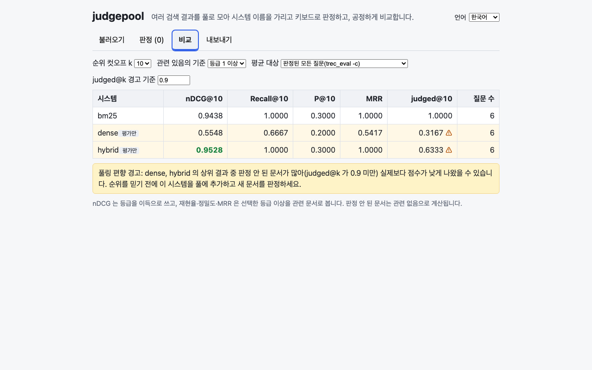
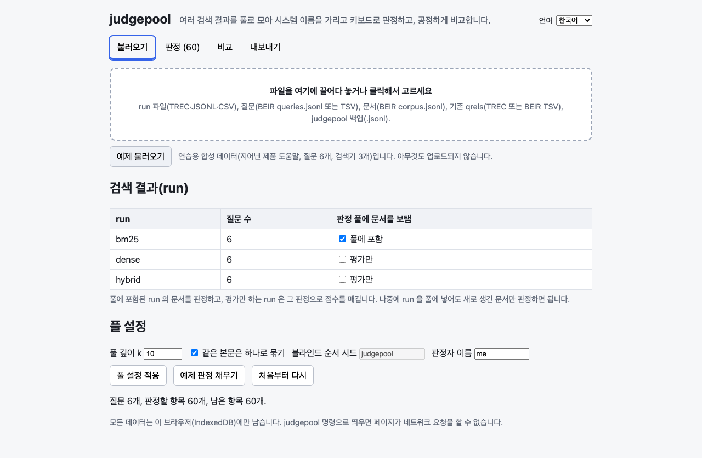
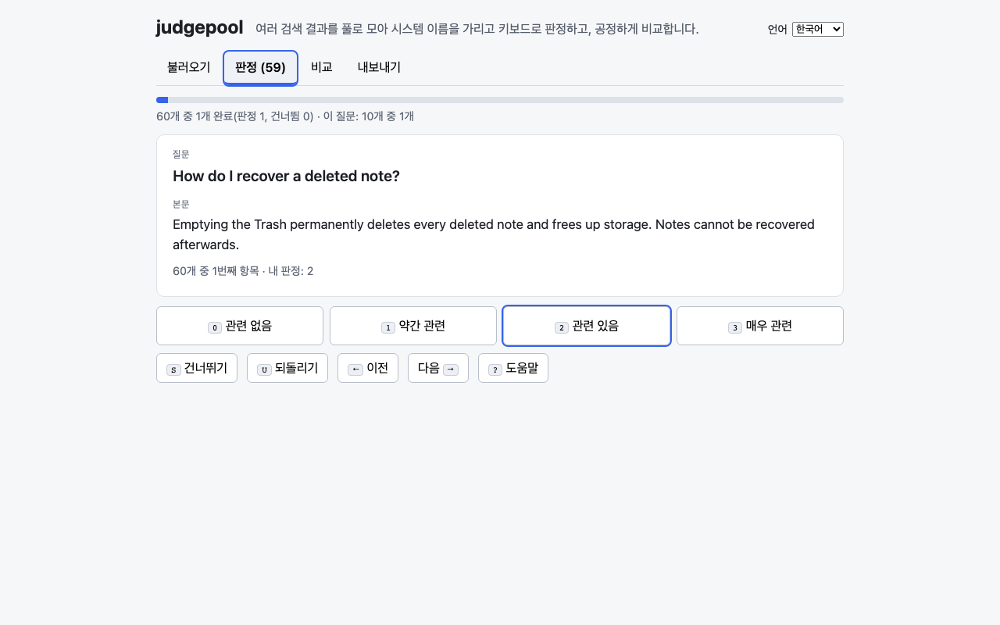
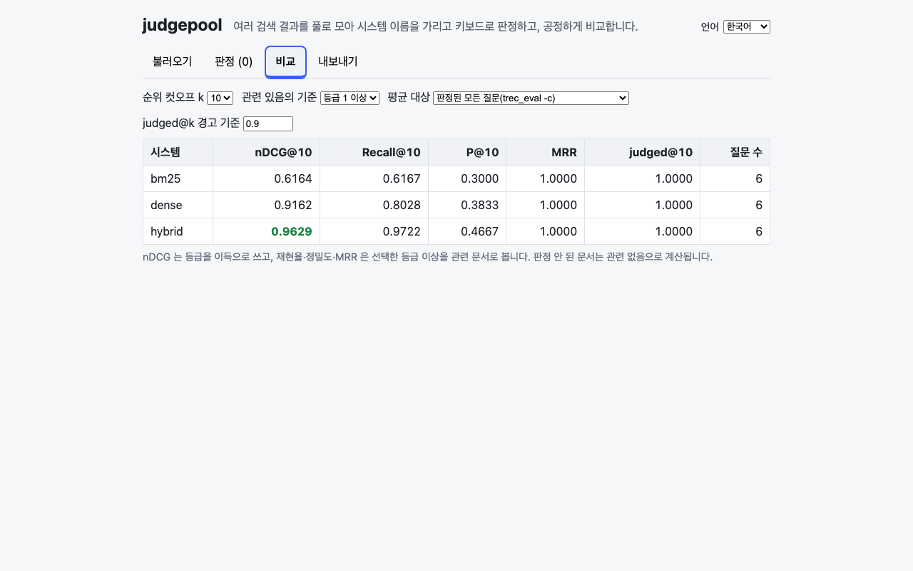
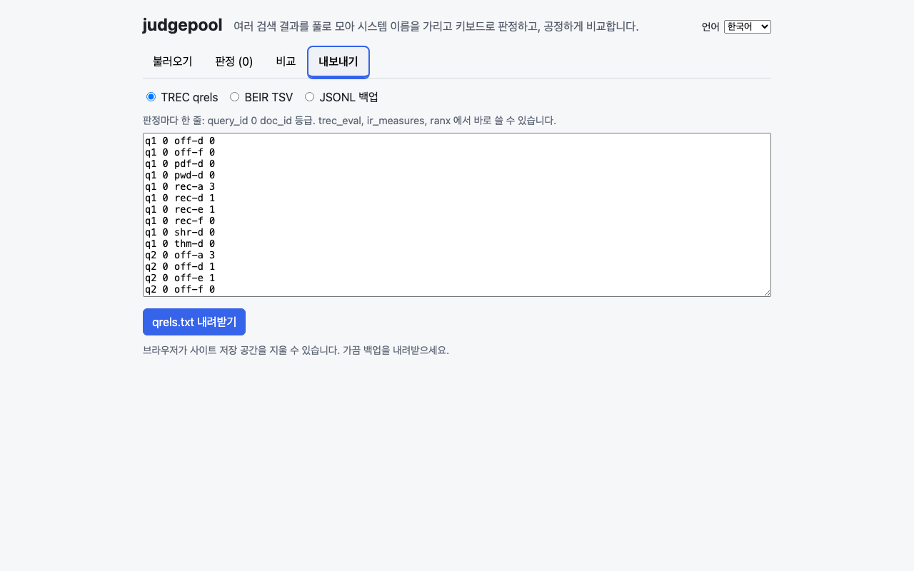
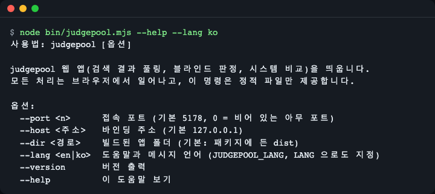
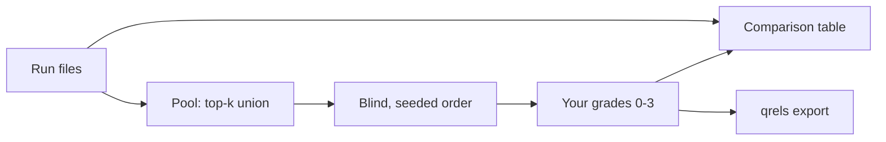

# judgepool

[English](README.md) | **한국어**

RAG 검색 단계의 정답셋을 브라우저에서 만듭니다. 여러 검색 설정의 결과를 풀로 모으고, 시스템 이름이 가려진 채 키보드로 문서마다 관련도를 매기고, `trec_eval` 과 같은 순위 지표로 설정끼리 비교합니다. 정답셋이 한 시스템에 치우쳐 있으면 경고도 띄워 줍니다.


*bm25 풀만 판정하면 bm25 가 dense 보다 훨씬 좋아 보이고, dense 는 상위 결과 대부분이 판정되지 않아 경고가 붙습니다.*

## 이런 분께
- 청크 크기·임베딩 모델·하이브리드 가중치·리랭커를 바꿨는데 검색이 정말 나아졌는지 알고 싶지만, 질문-문서 관련도 정답이 아직 없는 분
- 설정별 검색 결과 파일이 몇 개 있고, 예시를 눈으로 훑는 대신 공정한 비교표 하나가 필요한 분
- `ir_measures`·`ranx`·직접 만든 평가 스크립트에 넣을 표준 `qrels` 파일(TREC·BEIR 형식)이 필요한 분

## 설치
Node.js 22.12 이상이 필요합니다(`brew install node`, 또는 [nodejs.org](https://nodejs.org/)). 앱을 쓰는 데 Python 은 필요 없습니다.

```bash
git clone https://github.com/LeeGyeongPil/judgepool.git
cd judgepool
npm install
```

## 빠르게 시작하기
```bash
npm start
```
앱을 빌드하고 `http://127.0.0.1:5178` 에서 서비스합니다. 그 주소를 열고 **예제 불러오기** 를 누른 뒤 [예제로 단계별 따라 하기](#예제로-단계별-따라-하기)를 따라가세요.

`npm run build` 뒤에는 `dist/index.html` 을 더블클릭해(`file://`) 서버 없이 열 수도 있습니다.

앱이 이미 빌드돼 있어 서버만 필요하면 실행 파일을 직접 쓰세요.

```bash
node bin/judgepool.mjs --port 5178
```
```text
judgepool is running at http://127.0.0.1:5178
Press Ctrl+C to stop.
```

(위 출력은 영어 설정에서 실행한 것입니다. 한국어 설정이면 "judgepool 이 http://127.0.0.1:5178 에서 실행 중입니다" 로 나옵니다.)

npm 에 패키지가 공개되면 `npx judgepool` 로 clone 없이 같은 서버를 띄울 수 있습니다(공개된 버전은 이 레포의 Releases 에서 확인하세요).

예제는 제가 직접 쓴 연습용 합성 데이터입니다. 가상의 노트 앱 도움말 문서, 질문 6개, 검색 run 3개로 이루어져 있고, 실제 검색기의 출력이 아닙니다. 아무것도 외부로 업로드되지 않습니다. 이 도구에는 모델·네트워크 호출이 없어서 따로 목(mock) 모드가 없습니다.

## 예제로 단계별 따라 하기

**1. 불러오기.** **예제 불러오기** 를 누릅니다. 불러오기 탭에 run 3개가 보이고, `bm25` 만 "풀에 포함"이며 `dense`·`hybrid` 는 "평가만"입니다. 처음 만든 시스템의 결과만 판정하고 나머지를 그 기준으로 채점하는, 흔히 문제를 일으키는 지름길입니다.


*run 표: 풀에 포함된 run 은 판정할 문서를 보태고, 평가만 하는 run 은 점수만 매깁니다.*

**2. 블라인드 판정.** **판정** 탭을 엽니다. 시스템 이름도 순위도 없이 질문 하나와 문서 하나만 보입니다. `0` `1` `2` `3` 을 눌러 등급(관련 없음, 약간 관련, 관련 있음, 매우 관련)을 매기면 다음 미판정 항목이 나옵니다. `S` 는 건너뛰기, `U` 는 되돌리기, 화살표는 이동, `?` 는 도움말입니다. 순서는 고정 시드로 섞이고, 판정은 브라우저에 자동 저장됩니다.


*질문 하나, 문서 하나, 등급 넷. 어느 시스템이 가져왔는지는 일부러 가려져 있습니다.*

**3. 비교: 치우친 풀.** 예제에서는 **예제 판정 채우기** 를 눌러(지금 풀에 들어 있는 모든 문서에 예제에 들어 있는 등급을 채웁니다. 이 시점에는 bm25 의 문서뿐입니다) **비교** 탭을 엽니다. bm25 풀만 판정한 상태입니다.


*bm25 nDCG@10 0.9438, dense 0.5548. dense 의 judged@10 은 0.3167 이라 경고가 붙습니다.*

여기서도 `hybrid`(0.9528)가 맨 위입니다. 두 시스템을 섞은 설정이라 최고 값 강조(초록)는 두 표 모두 hybrid 에 붙습니다. 볼 것은 bm25 대 dense 의 뒤집힘입니다. hybrid 자신의 judged@10 도 0.63 이라 이 치우친 풀에서의 점수는 믿기 어렵습니다.

`judged@10` 은 한 시스템의 상위 10개 결과 중 판정이 있는 비율입니다. 판정이 없는 문서는 관련 없음으로 세기 때문에, 결과가 한 번도 판정되지 않은 시스템은 부당하게 낮은 점수를 받습니다. 기준값(기본 0.9)보다 낮으면 그 행에 경고가 붙습니다.

**4. 비교: 전체 풀.** 불러오기 탭으로 돌아가 `dense` 와 `hybrid` 를 "풀에 포함"으로 바꿉니다. 풀이 커지고, 새로 생긴 문서만 판정하면 됩니다(앞선 판정은 그대로 남습니다). 예제에서는 **예제 판정 채우기** 를 다시 누르거나(또는 새 문서를 직접 판정하고) **비교** 탭을 엽니다.


*이제 dense nDCG@10 0.9162 가 bm25 0.6164 를 앞서고 경고도 없습니다. hybrid 는 0.9629 로 여전히 맨 위입니다. bm25 대 dense 순위가 뒤집혔습니다.*

**5. 내보내기.** **내보내기** 탭에서 정답셋을 TREC qrels, BEIR TSV, 나중에 다시 불러올 수 있는 JSONL 백업으로 받습니다.


*TREC qrels 한 줄은 `q1 0 rec-a 3` 처럼 질문, 0, 문서, 등급입니다.*

## 내 데이터로 쓰기
불러오기 탭에 아래 파일을 끌어다 놓으세요(형식은 자동 감지하고, 읽을 수 없는 줄은 줄 번호로 알려 주며 건너뜁니다).

| 파일 | 형식 |
|---|---|
| 검색 설정마다 run 파일 하나 | TREC(`qid Q0 docid rank score name`), JSONL, CSV. 파일 이름(확장자 제외)이 시스템 이름이 됩니다. |
| 질문 | BEIR `queries.jsonl` 또는 `id<TAB>text` |
| 코퍼스(문서 본문) | BEIR `corpus.jsonl` |
| 기존 정답(선택) | TREC qrels 또는 BEIR TSV |
| judgepool 백업 | 이전에 내보낸 `.jsonl` |

그다음 풀에 문서를 보탤 run 을 고르고, 풀 깊이 k(기본 10)를 정한 뒤 **풀 만들기** 를 누릅니다.

비어 있거나 위 형식 어디에도 해당하지 않는 파일은 불러오지 않고, 안내에 지원 형식이 나옵니다. `_id` 와 `text` 는 있고 `title` 이 없는 JSONL 은 파일 이름에 `corpus`·`passage`·`doc` 가 들어 있으면 코퍼스로(`quer` 가 들어 있으면 질문으로), 이름으로 알 수 없으면 본문이 300자보다 길 때 코퍼스로 읽습니다.

## 명령줄
| 명령·옵션 | 하는 일 |
|---|---|
| `node bin/judgepool.mjs` | `127.0.0.1:5178` 에서 앱 서비스 |
| `--port <n>` | 포트(`0` = 비어 있는 아무 포트) |
| `--host <주소>` | 바인딩 주소(기본 `127.0.0.1`) |
| `--dir <경로>` | 빌드된 앱 폴더(기본: 패키지에 든 `dist`) |
| `--lang en\|ko` | 도움말·메시지 언어 |
| `--version` | 버전 출력 |
| `--help` | 도움말 출력 |


*`node bin/judgepool.mjs --help`*

## 설정
- **화면 언어**: 오른쪽 위 언어 메뉴(영어·한국어). 처음 열 때만 브라우저 언어를 따르고, 고른 값은 저장됩니다. 주소의 `?lang=ko` 가 가장 우선합니다.
- **CLI 언어**: `--lang en|ko` > `JUDGEPOOL_LANG` > `LC_ALL`·`LC_MESSAGES`·`LANG` 순이며, 한국어가 아니면 영어입니다.
- **비교 옵션**(비교 탭): 컷오프 k, "관련 있음" 기준(1 이상 또는 2 이상), 평균 대상(판정된 모든 질문 = `trec_eval -c`, 또는 run 과 qrels 에 모두 있는 질문 = `trec_eval` 기본), judged@k 경고 기준값.
- 앱을 실행하는 데 필요한 환경변수는 없습니다.

## 지표와 trec_eval
같은 규칙을 쓰기 때문에 `trec_eval`·`ir_measures` 와 값이 같습니다.
- run 파일의 `rank` 열은 무시합니다. 점수 높은 순으로 다시 정렬하고, 점수가 같으면 문서 id 내림차순으로 정합니다(`trec_eval` 규칙). 예제 q1 에 이런 동점이 있습니다.
- 판정이 없는 문서는 이득·개수 계산에서 관련 없음으로 셉니다.
- nDCG@k 는 등급을 이득으로 쓰고 `1/log2(순위+1)` 로 할인하며, 이상적인 목록은 내 qrels 에서 만듭니다. 음수 등급은 이득 0 입니다.
- 재현율·정밀도·MRR 은 등급 1 이상(비교 탭에서 2 이상으로 바꿀 수 있음)을 관련 있음으로 봅니다. 정밀도는 항상 k 로 나눕니다. MRR 은 상위 k개가 아니라 run 전체에서 처음 나오는 관련 문서를 찾습니다.
- 질문 평균은 두 방식입니다. 판정이 있는 모든 질문(run 에 없는 질문은 0점, `trec_eval -c` 와 같음), 또는 run 과 qrels 에 모두 있는 질문만(`trec_eval` 기본).
- `judged@k` 는 상위 k개 결과 중 판정이 있는 비율입니다(run 이 k 보다 짧으면 실제 반환 수로 나눔). 판정 없는 문서에 기댄 점수가 많을 때 알려 주는 경험칙일 뿐 공정함의 증명이 아닙니다. 값이 높아도 풀이 치우치지 않았다는 뜻은 아니고, 기본 기준값 0.9 는 바꿀 수 있는 선택입니다.

## 내보내기 후 ir_measures 로 확인하기
내보내기 탭에서 TREC qrels(`qrels.txt`)를 받고, 옆에 run 파일(여기서는 예제의 `dense.run`)을 둡니다. [ir_measures](https://ir-measur.es/) 의 Python API 를 쓰세요(`pip install ir_measures`. 제 테스트에서 명령줄 도구는 Python 3.15 에서 실패해서 API 가 안전합니다).

```python
import ir_measures
from ir_measures import nDCG, Judged

qrels = list(ir_measures.read_trec_qrels("qrels.txt"))
run = list(ir_measures.read_trec_run("dense.run"))
print(ir_measures.calc_aggregate([nDCG @ 10, Judged @ 10], qrels, run))
```
```text
{nDCG@10: 0.9162128513264478, Judged@10: 1.0}
```
전체 풀 예제 qrels 와 `dense.run` 의 결과이며, 비교 표도 같은 0.9162 와 1.0 을 보여 줍니다.

## 동작 원리

- run 파일은 검색 설정마다의 순위 결과입니다.
- 풀은 고른 run 들의 상위 k개 문서의 합집합이며, 중복은 문서 id(선택하면 같은 본문 텍스트까지)로 합칩니다.
- 판정 화면은 질문과 문서 본문만 받으므로 특정 시스템을 편들 수 없습니다.
- 매긴 등급이 곧 qrels 입니다. 비교표는 평가만 하는 run 을 포함해 모든 run 을 이 qrels 로 채점합니다.
- 지표는 `ir_measures` 0.4.3 기준값(`src/core/__fixtures__/ref.json` 에 커밋)과 소수 6자리까지 같은지 테스트로 확인합니다.
- 페이지는 네트워크 요청을 하지 않습니다. `judgepool` 명령은 `connect-src 'none'` 콘텐츠 보안 정책(CSP)과 함께 서비스합니다.

## 언제 쓰나
- 잘 맞는 경우: 내 문서로 검색 설정 몇 가지를 비교하는데, 서버 설치 없이 정답과 공정한 비교표가 필요할 때
- 다른 도구가 나은 경우: 정답이 이미 있고 지표만 필요하면 [ir_measures](https://ir-measur.es/)·[ranx](https://github.com/AmenRa/ranx), 여러 사람이 쓰는 호스팅 라벨링 서비스가 필요하면 [Label Studio](https://labelstud.io/), 팀이 운영 중인 검색 엔진을 튜닝하면 [Quepid](https://quepid.com/)

## 한계와 로드맵
- `judged@k` 는 경험칙입니다([지표와 trec_eval](#지표와-trec_eval) 참고).
- 파일은 UTF-8 이어야 합니다. 다른 인코딩(예: CP949)은 오류 없이 읽히지만 id 가 말뭉치·qrels 와 맞지 않습니다. 먼저 UTF-8 로 저장하세요.
- 한 사람, 한 브라우저: 데이터는 그 브라우저 저장소에만 있습니다. 여러 사용자 모드와 동기화는 없으니, 옮기거나 보관하려면 JSONL 백업을 내보내세요.
- 풀은 고른 run 마다 단순한 상위 k개를 가져옵니다. 우선순위 풀링(여러 run 에 겹치는 문서를 먼저 판정)은 아직 없습니다.
- 다음 단계: 여러 판정자 병합과 일치도(M2), 우선순위 풀링과 유의성 검정(M3). 계획일 뿐 약속은 아닙니다.

## 자주 겪는 문제
| 증상 | 원인 | 해결 |
|---|---|---|
| `dist/index.html` 을 열면 빈 화면 | 아직 빌드하지 않았거나 예전 모듈 스크립트 빌드를 열었음 | `npm run build` 후 `dist/index.html` 을 다시 열기(빌드 결과는 `file://` 에서도 동작하며, 저장된 판정은 그 브라우저에 남음) |
| `Port 5178 is already in use` | 다른 프로세스가 그 포트를 씀 | `node bin/judgepool.mjs --port 0` |
| 폴더에서 `index.html` 을 찾지 못함 | 앱이 빌드되지 않음 | `npm run build`, 또는 `--dir <폴더>` 지정 |
| 파일을 불러온 뒤 "건너뛴 줄" 안내 | 일부 줄이 형식과 맞지 않음 | 안내를 열어 표시된 줄 번호를 고침. 지원 형식은 [내 데이터로 쓰기](#내-데이터로-쓰기) 참고 |
| 풀링 편향 경고 | 한 시스템의 상위 결과 다수에 판정이 없음 | 그 run 을 풀에 넣고 새 문서를 판정 |
| "이 브라우저에 저장하지 못했습니다" | 사생활 보호 모드 또는 저장 공간 부족 | 내보내기 탭에서 JSONL 백업 받기 |

## 개발·기여
```bash
npm test
npm run build
npm run lint
```
테스트 179개가 1초 안팎에 돌아갑니다. 기준값을 다시 만들려면 [uv](https://docs.astral.sh/uv/)(`brew install uv`)가 필요합니다: `cd scripts/ref && uv run python make_ref.py`.

버그·제안은 이슈로 남겨 주세요. 변경 기록은 [CHANGELOG.md](CHANGELOG.md).

## 라이선스
MIT. 예제 데이터는 이 프로젝트를 위해 지어낸 것이며 같은 라이선스입니다.
