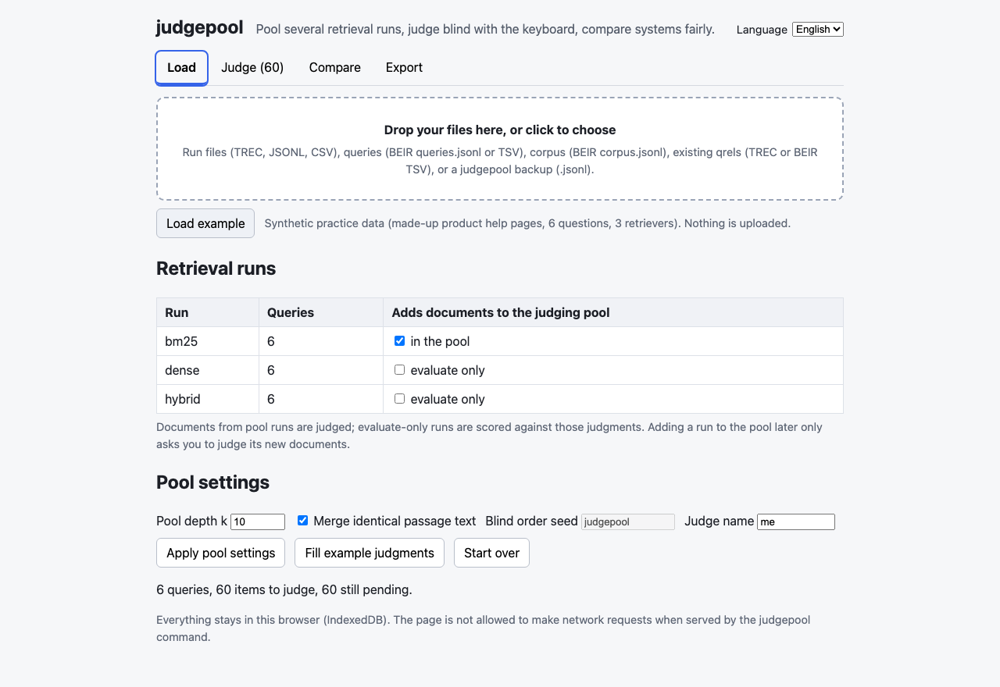
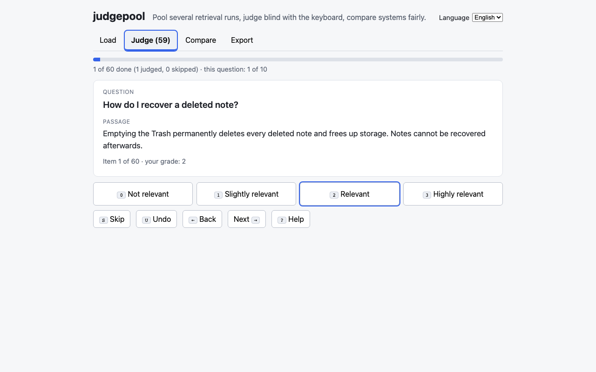
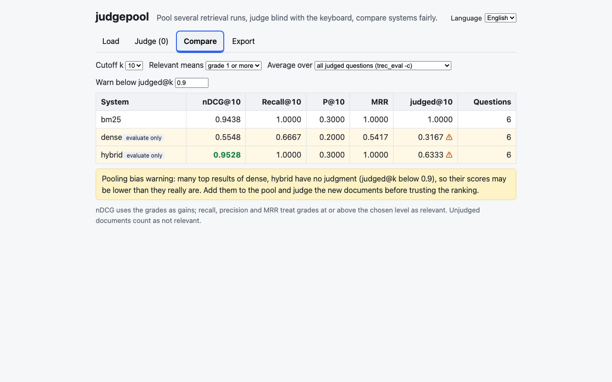
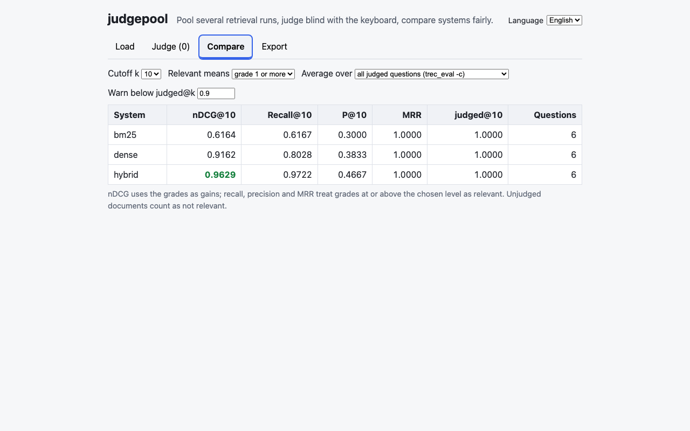
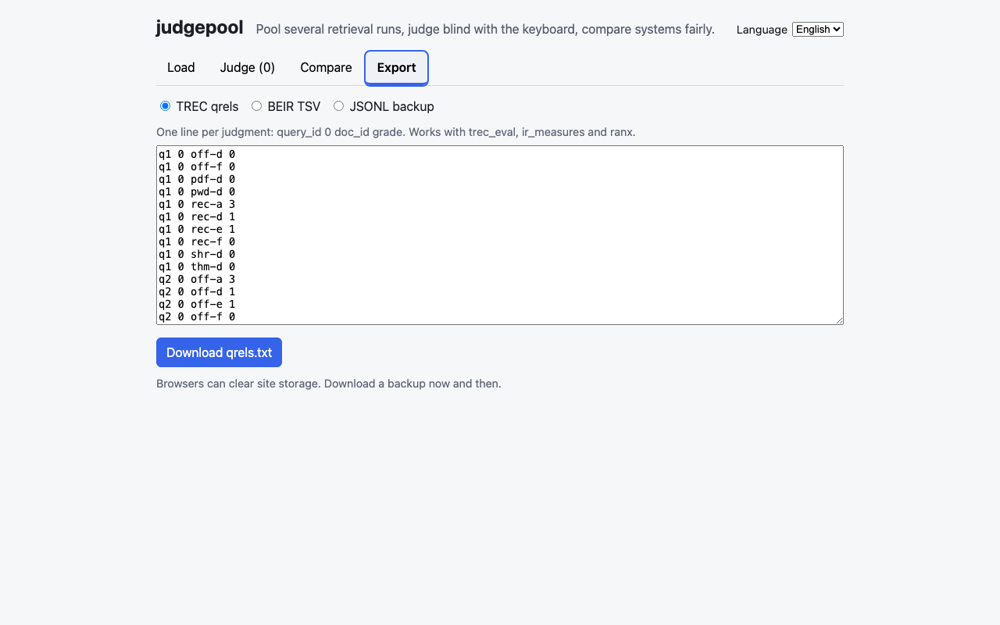
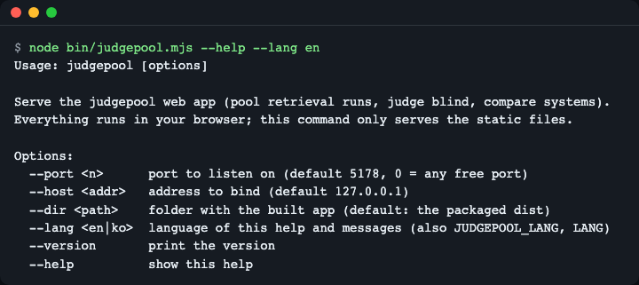
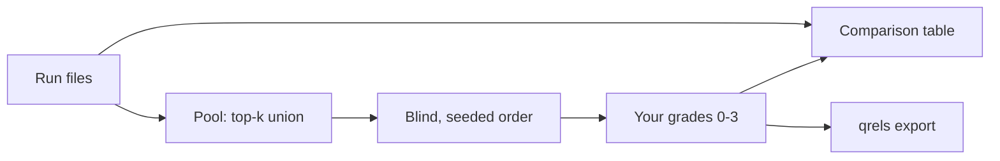

# judgepool

**English** | [한국어](README.ko.md)

Build the answer key for your RAG retrieval step in the browser: pool the results of several retrieval settings, judge each passage blind with the keyboard, and compare the settings with the same ranking metrics `trec_eval` uses. A warning tells you when your answer key is biased toward one system.


*After judging only the bm25 pool, bm25 looks far better than dense, and dense is flagged because most of its top results were never judged.*

## Who it is for
- You changed a chunk size, an embedding model, a hybrid weight or a reranker and want to know if retrieval really got better, but you have no question-to-passage relevance labels yet.
- You have a few result files from different settings and want one fair table instead of eyeballing examples.
- You need a standard `qrels` file (TREC or BEIR format) to feed into `ir_measures`, `ranx` or your own evaluation script.

## Install
Requires Node.js 22.12 or newer (`brew install node`, or see [nodejs.org](https://nodejs.org/)). Python is not needed to use the app.

```bash
git clone https://github.com/LeeGyeongPil/judgepool.git
cd judgepool
npm install
```

## Quick start
```bash
npm start
```
This builds the app and serves it at `http://127.0.0.1:5178`. Open that address, press **Load example**, and follow [Step by step](#step-by-step-with-the-built-in-example).

After `npm run build` you can also double-click `dist/index.html` (opened as `file://`); no server is needed.

If you only want the server (the app is already built), run the launcher directly:

```bash
node bin/judgepool.mjs --port 5178
```
```text
judgepool is running at http://127.0.0.1:5178
Press Ctrl+C to stop.
```

Once the package is published to npm, `npx judgepool` starts the same server without cloning (check the Releases page of this repository for the published version).

The example is synthetic practice data that I wrote by hand: made-up help pages of an imaginary notes app, 6 questions and 3 retrieval runs. It is not the output of real retrievers, and nothing is uploaded anywhere. There is no model or network call in this tool, so there is no separate mock mode.

## Step by step with the built-in example

**1. Load.** Press **Load example**. The Load tab lists three runs. Only `bm25` is marked "in the pool"; `dense` and `hybrid` are "evaluate only". This is the usual shortcut that causes trouble: you judge what the first system found and score the others against it.


*The runs table: a run in the pool contributes documents to be judged; an evaluate-only run is just scored.*

**2. Judge blind.** Open the **Judge** tab. You see a question and one passage, with no system name and no rank. Press `0` `1` `2` `3` to grade it (not relevant, slightly relevant, relevant, highly relevant); the next unjudged item appears. `S` skips, `U` undoes, the arrow keys move, `?` shows help. The order is shuffled with a fixed seed, and every judgment is saved in your browser automatically.


*One question, one passage, four grades. Which system returned it is hidden on purpose.*

**3. Compare, biased pool.** For the example, press **Fill example judgments** (it grades every passage currently in the pool with the grades shipped in the example; at this point that is only bm25's documents), then open **Compare**. With only the bm25 pool judged:


*bm25 nDCG@10 0.9438, dense 0.5548. dense judged@10 is 0.3167, so it gets a warning.*

Note that `hybrid` (0.9528) is on top here too. It mixes both systems, so the green best value stays on it in both tables. The flip to watch is bm25 versus dense. hybrid's own judged@10 is 0.63, so its score in this biased pool cannot be trusted either.

`judged@10` is the share of a system's top 10 results that have a judgment. Documents without a judgment count as not relevant, so a system whose results were never judged is punished unfairly. Below the threshold (default 0.9) the row is flagged.

**4. Compare, full pool.** Back on the Load tab, switch `dense` and `hybrid` to "in the pool". The pool grows; only the new passages need judging (your earlier judgments stay). For the example, press **Fill example judgments** again (or judge the new passages yourself), then open **Compare**:


*dense nDCG@10 0.9162 now beats bm25 0.6164, and no row has a warning. hybrid stays on top at 0.9629. The bm25 versus dense ranking flipped.*

**5. Export.** The **Export** tab gives you the answer key as a TREC qrels file, a BEIR TSV, or a JSONL backup you can load again later.


*TREC qrels lines look like `q1 0 rec-a 3`: question, 0, document, grade.*

## Use it with your own data
Drop these files on the Load tab (format is detected automatically; lines that cannot be read are listed by line number and skipped):

| File | Format |
|---|---|
| One run file per retrieval setting | TREC (`qid Q0 docid rank score name`), JSONL or CSV. The file name (without extension) becomes the system name. |
| Queries | BEIR `queries.jsonl` or `id<TAB>text` |
| Corpus (passage text) | BEIR `corpus.jsonl` |
| Existing labels (optional) | TREC qrels or BEIR TSV |
| A judgepool backup | `.jsonl` exported earlier |

Then choose which runs contribute to the pool, set the pool depth k (default 10), and press **Build pool**.

A file that is empty or in none of these formats is not loaded; the note lists the accepted formats. A JSONL file with `_id` and `text` but no `title` is read as a corpus when its name contains `corpus`, `passage` or `doc` (as queries when it contains `quer`), or else when the texts are longer than 300 characters.

## Command line
| Command | What it does |
|---|---|
| `node bin/judgepool.mjs` | Serve the app on `127.0.0.1:5178` |
| `--port <n>` | Port (`0` = any free port) |
| `--host <addr>` | Address to bind (default `127.0.0.1`) |
| `--dir <path>` | Folder with a built app (default: the packaged `dist`) |
| `--lang en\|ko` | Language of the help and messages |
| `--version` | Print the version |
| `--help` | Show the help |


*`node bin/judgepool.mjs --help`*

## Settings
- **Screen language**: the menu at the top right (English or Korean). The first visit follows the browser language and your choice is saved. `?lang=ko` in the address overrides it.
- **CLI language**: `--lang en|ko`, then `JUDGEPOOL_LANG`, then `LC_ALL`, `LC_MESSAGES`, `LANG`; anything that is not Korean falls back to English.
- **Comparison options** (Compare tab): cutoff k, "relevant means grade 1+ or 2+", how to average (all judged questions, like `trec_eval -c`, or only questions present in both run and qrels, the `trec_eval` default), and the judged@k warning threshold.
- No environment variable is needed to run the app.

## Metrics and trec_eval
The numbers match `trec_eval` / `ir_measures` because the same rules are used:
- The `rank` column of a run file is ignored. Documents are re-sorted by score, highest first; equal scores are ordered by document id, descending (the `trec_eval` rule). The example has such a tie in q1.
- A document without a judgment counts as not relevant for the gain and the counts.
- nDCG@k uses the grade as gain with a `1/log2(rank+1)` discount; the ideal list comes from your qrels. Negative grades count as 0 gain.
- Recall, precision and MRR treat a document as relevant at grade 1 or higher (or 2 or higher, your choice in Compare). Precision always divides by k. MRR looks for the first relevant document in the whole run, not only the top k.
- Two ways to average over questions: all questions that have judgments (a question missing from a run scores 0, like `trec_eval -c`), or only questions present in both the run and the qrels (the `trec_eval` default).
- `judged@k` is the share of the top k results that have any judgment (when a run is shorter than k, it divides by the number returned). It is a rule of thumb that warns when many scores rest on unjudged documents, not a proof of fairness: a high value does not mean the pool is unbiased, and the default threshold of 0.9 is a choice you can change.

## Export and check with ir_measures
On the Export tab download the TREC qrels (`qrels.txt`) and put a run file next to it (here the example's `dense.run`). Use the Python API of [ir_measures](https://ir-measur.es/) (`pip install ir_measures`; its command-line tool failed on Python 3.15 in my test, so the API is the safe route):

```python
import ir_measures
from ir_measures import nDCG, Judged

qrels = list(ir_measures.read_trec_qrels("qrels.txt"))
run = list(ir_measures.read_trec_run("dense.run"))
print(ir_measures.calc_aggregate([nDCG @ 10, Judged @ 10], qrels, run))
```
```text
{nDCG@10: 0.9162128513264478, Judged@10: 1.0}
```
This is the full-pool example qrels and `dense.run`; the Compare table shows the same 0.9162 and 1.0.

## How it works

- Run files are the ranked results of each retrieval setting.
- The pool is the union of the top k documents of the runs you choose, with duplicates merged (by document id, and optionally by identical passage text).
- The judging screen only gets the question and passage text, so you cannot favour a system.
- Your grades become the qrels. The table scores every run against them, including the evaluate-only runs.
- The metrics are checked against `ir_measures` 0.4.3 (reference values committed in `src/core/__fixtures__/ref.json`) to 6 decimals.
- The page makes no network requests; the `judgepool` command serves it with a Content-Security-Policy of `connect-src 'none'`.

## When to use it
- A good fit: you compare a handful of retrieval settings on your own documents and need labels plus a fair table, without setting up a server.
- Other tools fit better when: you already have labels and only need metrics, try [ir_measures](https://ir-measur.es/) or [ranx](https://github.com/AmenRa/ranx); you need a hosted multi-user labeling service, try [Label Studio](https://labelstud.io/); you tune a live search engine with a team, see [Quepid](https://quepid.com/).

## Limitations and roadmap
- `judged@k` is a heuristic (see [Metrics and trec_eval](#metrics-and-trec_eval)).
- Files must be UTF-8. A file in another encoding (for example CP949) loads without an error, but its ids will not match the corpus or qrels. Save it as UTF-8 first.
- One person, one browser: your data stays in that browser's storage. There is no multi-user mode and no sync; export a JSONL backup to move or keep it.
- The pool takes the plain top k of each chosen run. Priority pooling (judging the most-shared documents first) is not built yet.
- Next milestones: merging several judges and agreement scores (M2); priority pooling and significance tests (M3). These are plans, not promises.

## Troubleshooting
| Symptom | Cause | Fix |
|---|---|---|
| A blank page after opening `dist/index.html` | The app is not built yet, or an old module-script build is open | Run `npm run build`, then open `dist/index.html` again (the build works from `file://`; saved judgments stay in that browser) |
| `Port 5178 is already in use` | Another process uses the port | `node bin/judgepool.mjs --port 0` |
| Cannot find `index.html` in the folder | The app is not built | `npm run build`, or pass `--dir <folder>` |
| A "problem lines (skipped)" note after loading a file | Some lines do not match the format | Open the note, fix the listed line numbers; see [Use it with your own data](#use-it-with-your-own-data) for the accepted formats |
| A pooling bias warning | Many top results of a system have no judgment | Put that run in the pool and judge the new passages |
| "Could not save to this browser" | Private mode or full storage | Export a JSONL backup from the Export tab |

## Development
```bash
npm test
npm run build
npm run lint
```
183 tests run in about a second. To regenerate the reference values you need [uv](https://docs.astral.sh/uv/) (`brew install uv`): `cd scripts/ref && uv run python make_ref.py`.

Bugs and ideas are welcome as issues. Changes are listed in [CHANGELOG.md](CHANGELOG.md).

## License
MIT. The example data is invented for this project and is under the same license.
